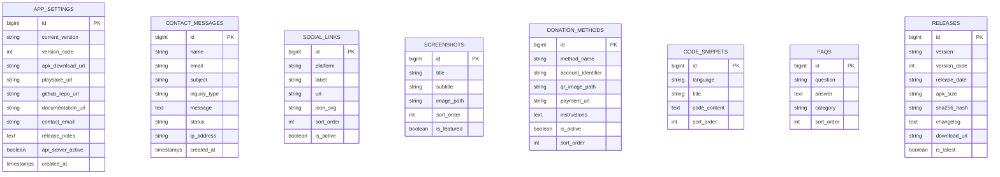

# 📄 Product Requirement Document (PRD) & Blueprint
## PocketSQL Official Website (Laravel Implementation)

---

## 📌 1. Project Overview & Objectives

### 1.1 Executive Summary
**PocketSQL** is an open-source, high-performance Android application featuring an embedded native SQL database engine and a persistent background HTTP/TLS API server. The goal of this project is to build an official, high-converting, fully dynamic showcase and distribution website using the **Laravel** framework.

### 1.2 Core Objectives
* **Comprehensive Multi-Page Experience**: Provide dedicated, beautifully crafted pages for **Home**, **About**, **Features**, **API Documentation**, **Downloads/Releases**, **Contact Us**, **Community & Donations**, **FAQ**, and **Legal Policies**.
* **Streamline App Distribution**: Provide clear, dynamic download buttons for direct APK downloads (with version, file size, SHA-256 checksums, and changelog) and the Google Play Store.
* **Full Dynamic Content Management**: Allow administrators to update app versions, download URLs, social links, screenshots, contact messages, FAQ entries, and donation channels from a database-driven backend/admin without modifying code.
* **Interactive Contact & Support**: A functional Contact Us form with database logging, validation, anti-spam, and email notification dispatch.
* **Community Support & Donations**: Seamless integration of donation options (UPI QR, Buy Me A Coffee, PayPal, GitHub Sponsors) for ongoing open-source support.
* **Transparent Legal Policies**: Host dedicated, SEO-optimized pages for Privacy Policy, Terms of Service, and Security Policy.

---

## 🎨 2. UI/UX Design System & Aesthetic Guidelines

### 2.1 Color Palette (Clean White Minimalist Theme)
The website must feature an ultra-clean, modern white theme with high readability and subtle contrast, avoiding heavy dark backgrounds on page containers:
* **Primary Page Background**: `#FFFFFF` (Pure White)
* **Secondary / Card Background**: `#F8FAFC` (Slate 50) or `#FFFFFF` with clean 1px border
* **Borders & Dividers**: `#E2E8F0` (Slate 200) / `#CBD5E1` (Slate 300)
* **Primary Brand Accent**: `#2563EB` (Royal Blue) / `#007ACC` (PocketSQL Blue)
* **Secondary Accent**: `#10B981` (Emerald Green - for "Active/Online" server badges)
* **Typography Color**:
  * Headings: `#0F172A` (Slate 900 - high contrast, bold)
  * Body Text: `#475569` (Slate 600 - readable, calm)
  * Muted Labels & Hints: `#64748B` (Slate 500)

### 2.2 Border Radius Constraint (Strict Requirement)
* **Maximum Radius**: **10px** (`border-radius: 10px;` or Tailwind `rounded-[10px]`).
* Applies to:
  * Cards & feature containers
  * App screenshot frames & modals
  * Buttons & CTA pills
  * Code snippet boxes
  * Form inputs & textareas
  * QR Code containers
  * Dropdowns & accordions

### 2.3 Typography & Elevation
* **Primary Font**: `Inter` or `Plus Jakarta Sans` (Clean, professional sans-serif).
* **Code / Terminal Font**: `JetBrains Mono` or `Fira Code` (Used for SQL queries, terminal previews, and client SDK code tabs).
* **Shadows**: Soft, ultra-subtle ambient shadows (`shadow-sm`, `box-shadow: 0 2px 8px rgba(0, 0, 0, 0.04)`). Avoid harsh, dark dropshadows.

---

## 🏗️ 3. Laravel System Architecture & Tech Stack

### 3.1 Technology Stack
* **Backend Framework**: Laravel 11.x (PHP 8.2+)
* **Database**: MySQL / MariaDB (or SQLite for lightweight single-server setups)
* **Frontend Templating**: Laravel Blade Components (`x-layout`, `x-card`, `x-button`, `x-navbar`, `x-footer`)
* **Styling**: Tailwind CSS 3.4+ (Customized with `max-w-7xl` containers and `rounded-[10px]`)
* **Interactivity**: Alpine.js (Lightweight for tabs, screenshot lightbox, mobile menu, accordion FAQs, and copy-to-clipboard)
* **Assets Bundler**: Vite 5.x
* **Icons**: Lucide Icons or Heroicons (SVG format)

### 3.2 Database Schema (Dynamic Architecture)



---

## 📑 4. Required Pages Breakdown & Wireframes

Below is the exhaustive specification for each of the required pages:

```
├── 1. Home Page (/)
├── 2. About Us (/about)
├── 3. Features (/features)
├── 4. Documentation & API Reference (/docs)
├── 5. Downloads & Releases (/download)
├── 6. Contact Us (/contact)
├── 7. Community & Donate (/donate)
├── 8. Frequently Asked Questions (/faq)
├── 9. Privacy Policy (/privacy-policy)
└── 10. Terms of Service (/terms)
```

---

### 4.1 Page 1: Home Page (`/`)

#### Purpose
Main landing page acting as the primary conversion funnel for app downloads and developer discovery.

#### Key Sections:
1. **Sticky Header / Navigation**:
   * Brand Logo + Wordmark (`PocketSQL`).
   * Nav Links: Home, Features, About, Docs, Download, Donate, Contact.
   * Direct CTAs: "Download APK" (secondary button) + "Get on Google Play" (primary button).
2. **Hero Section**:
   * Version Badge: `🟢 v1.0.5 — Android 10 to 15 Ready • Open Source`.
   * Catchy Headline: *"Run a Full MySQL Database Engine on Your Android Device. Connect from Anywhere."*
   * Sub-description highlighting zero root requirement, embedded HTTP/TLS server, and JetBrains Mono CLI.
   * Dual Action CTAs: Google Play Store badge + Direct APK Download button (with size badge).
   * Interactive phone mockup showing `terminal_welcome.png` with floating badges (*"Port 8080 Active"*, *"AES-256 Storage"*).
3. **Quick Feature Preview (6 Grid Cards - Max 10px Radius)**:
   * Embedded SQL Engine, Terminal CLI, Background REST API, 40+ System Tables, Multi-Format Exporter, Mobile Security.
4. **App Screenshots Showcase (5 Carousel / Grid Cards - Max 10px Radius)**:
   * Interactive cards showing `terminal_welcome.png`, `terminal_select.png`, `terminal_insert.png`, `sql_templates.png`, and `api_keys_server.png`.
   * Click-to-enlarge lightbox modal powered by Alpine.js.
5. **Interactive Quick-Start Client Tabs**:
   * Switchable tabs for Python, JavaScript, Java, PHP, and Bash (cURL) with 1-click copy.
6. **Community & Donation Callout**:
   * Banner encouraging open-source sponsorship linking to `/donate`.
7. **Quick FAQ Accordion (Top 4 questions)**.
8. **Final Download Banner & Footer**.

---

### 4.2 Page 2: About Us (`/about`)

#### Purpose
Provides background context, mission, technology architecture, and team/author details.

#### Key Sections:
1. **The PocketSQL Story**:
   * Why PocketSQL was created: The need for an independent, fully local, offline SQL environment for students, mobile developers, and IoT prototypes without renting cloud instances.
2. **Architecture Philosophy**:
   * How the custom pure-Java engine executes queries without external binary dependencies.
   * Detailed breakdown of the Parser, Storage Engine, Transaction Manager, and Foreground Service.
3. **Core Principles**:
   * **100% Privacy & Offline-First**: No data leaves the phone unless queried via local API key.
   * **Zero Cloud Lock-in**: User databases are stored as transparent JSON/SQLCipher files.
   * **Community Driven**: Free & open-source under the MIT license.
4. **Developer & Contributors Section**:
   * Creator bio, links to GitHub, LinkedIn, and social profiles.
   * "Made with ❤️ in India" badge.

---

### 4.3 Page 3: Features Overview (`/features`)

#### Purpose
In-depth technical breakdown of every single capability in PocketSQL.

#### Content Modules (Each card `max 10px radius`, white background):
1. **SQL Language & Engine Capabilities**:
   * CRUD Operations (`SELECT`, `INSERT`, `UPDATE`, `DELETE`, `REPLACE`).
   * Complex Joins (`INNER`, `LEFT`, `RIGHT`, `CROSS JOIN`).
   * Analytical Window Functions (`PERCENT_RANK()`, `NTILE()`).
   * Auto-updating timestamps (`ON UPDATE CURRENT_TIMESTAMP`).
   * Constraint enforcement (`PRIMARY KEY`, `FOREIGN KEY`, `UNIQUE`, `CHECK`, `NOT NULL`).
2. **Interactive Terminal Console**:
   * Custom JetBrains Mono typography.
   * Real-time autocomplete suggestions (`SqlKeywordSuggester.java`).
   * Multi-line query buffer with custom delimiters (`DELIMITER //`).
   * 200+ built-in `HELP <topic>;` commands.
3. **Embedded HTTP & TLS REST API Server**:
   * Android Foreground Service persistent execution.
   * Automatic port scanning fallback (`8080` to `8099`).
   * On-device TLS 1.3 self-signed certificate generator (`AndroidCertGenerator.java`).
   * Per-database Bearer API key authorization (`SqlApiKeyManager.java`).
4. **40+ MySQL System Tables Emulation**:
   * Complete support for `mysql`, `information_schema`, `performance_schema`, and `sys` databases.
5. **Export & Import Engine**:
   * SQLite / SQLCipher encrypted `.db` export.
   * Raw `.sql` script generation.
   * ZIP-compressed `.csv` files and formatted Excel `.xlsx` spreadsheets.
6. **Mobile Security & Performance**:
   * AES-256 encrypted settings (`EncryptedSharedPreferences`).
   * Play Integrity tamper verification (`AppIntegrityManager.java`).
   * Thread priority scheduler for smooth background operation.

---

### 4.4 Page 4: Documentation & API Reference (`/docs`)

#### Purpose
Complete developer handbook for interacting with the PocketSQL API Server from external devices.

#### Key Content:
1. **Getting Started Guide**:
   * How to start the background service from the Android notification bar or UI.
   * Finding the active IP address and port (`http://<device-ip>:8080/api/query`).
   * Generating API Keys in the PocketSQL app.
2. **HTTP API Reference Specification**:
   * **Endpoint**: `POST /api/query`
   * **Headers**:
     * `Authorization: Bearer <API_KEY>`
     * `Content-Type: application/json`
   * **Request Body Payload**:
     ```json
     {
       "database": "ecommerce",
       "sql": "SELECT id, product_name, price FROM products LIMIT 5;"
     }
     ```
   * **Success Response Schema (`200 OK`)**:
     ```json
     {
       "success": true,
       "columns": ["id", "product_name", "price"],
       "rows": [
         {"id": 1, "product_name": "Laptop", "price": 899.99}
       ],
       "affected_rows": 0,
       "executionTimeMs": 14
     }
     ```
   * **Error Response Schema (`400 / 403 / 500`)**:
     ```json
     {
       "success": false,
       "error": "Error 1146 (42S02): Table 'ecommerce.invalid_table' doesn't exist"
     }
     ```
3. **Copy-Paste Client Connectors**:
   * Ready-to-run scripts for Python, Node.js, Java, PHP, and cURL.

---

### 4.5 Page 5: Downloads & Release Archive (`/download`)

#### Purpose
Dedicated distribution hub containing latest and historical APK releases.

#### Key Elements (All cards with `max 10px radius`):
1. **Latest Release Card (Featured)**:
   * Version: `v1.0.5 (Build 11)`
   * Release Date: Current / Dynamic
   * File Size: `~12.4 MB`
   * SHA-256 Checksum: `[Copy SHA256]`
   * Prominent **"Download Official APK"** button.
   * Prominent **"Get it on Google Play"** button.
   * Changelog / Release Notes accordion.
2. **System Requirements Card**:
   * Android OS: Android 10.0 (API 29) through Android 15 (API 36).
   * Storage: 25 MB free space.
   * Root: **Not Required**.
3. **Previous Releases Table**:
   * List of past versions (`v1.0.4`, `v1.0.3`) with download links and changelogs.
4. **Installation & Security Verification Guide**:
   * Step-by-step instructions on enabling "Install from Unknown Sources" and verifying APK signature.

---

### 4.6 Page 6: Contact Us (`/contact`)

#### Purpose
Enables users, developers, and corporate sponsors to get in touch, report bugs, or ask questions.

#### Layout & Components:
1. **Contact Information Cards (Left Column - Max 10px Radius)**:
   * **Official Email**: `support@pocketsql.app` (or dynamic from DB).
   * **GitHub Issues**: Direct link to file bug reports.
   * **Discord / Telegram**: Real-time community support links.
   * **Response Time**: Notice stating typical reply time (within 24-48 hours).
2. **Interactive Contact Form (Right Column - Max 10px Radius Card)**:
   * **Fields**:
     * `Full Name` (required, text)
     * `Email Address` (required, email)
     * `Inquiry Type` (dropdown: Bug Report, Feature Request, Sponsorship/Donation, General Inquiry)
     * `Subject` (required, text)
     * `Message` (required, textarea)
     * Anti-spam Honeypot / Cloudflare Turnstile or reCAPTCHA
   * **Form Action**: `POST /contact`
   * **Backend Handling**:
     * Validates input fields.
     * Stores inquiry in `contact_messages` database table with IP and status `unread`.
     * Sends email notification to the site administrator.
     * Displays clean success alert (`"Thank you! Your message has been sent."`).

---

### 4.7 Page 7: Community & Donate (`/donate`)

#### Purpose
Dedicated community sponsorship page to fund development, testing devices, and hosting.

#### Layout & Components (All white cards, `max 10px radius`):
1. **Mission Statement**:
   * *"PocketSQL is 100% free and open-source. Your contribution helps us maintain Android compatibility, develop new SQL features, and keep the project independent."*
2. **Payment Channels**:
   * **UPI Payment Card (India)**:
     * High-resolution UPI QR Code image.
     * UPI ID display with a 1-click **"Copy UPI ID"** button (`your_upi_id@upi`).
     * Supported apps icons: Google Pay, PhonePe, Paytm, BHIM.
   * **Buy Me a Coffee**:
     * Custom button / embedded widget.
   * **PayPal**:
     * Direct PayPal.me link for international community members.
   * **GitHub Sponsors**:
     * Direct link to sponsor the developer on GitHub.
   * **Crypto Donations (Optional)**:
     * USDT (TRC-20) / Bitcoin address with copy button.
3. **Supporters Wall (Optional Dynamic Feature)**:
   * Grid of community donors / sponsors who contributed.

---

### 4.8 Page 8: Frequently Asked Questions (`/faq`)

#### Purpose
Self-serve knowledge base reducing support emails.

#### Categorized Accordions (Alpine.js powered, `max 10px radius`):
* **General**:
  * *Does PocketSQL require root access?* (No, works entirely in user space).
  * *Is PocketSQL free to use commercially?* (Yes, licensed under MIT).
* **API & Networking**:
  * *How do I connect from my laptop to PocketSQL on my phone?* (Ensure both are on the same Wi-Fi; connect to `http://<phone_ip>:8080/api/query`).
  * *What happens if port 8080 is busy?* (PocketSQL automatically binds to the next free port between 8080 and 8099).
* **Battery & Performance**:
  * *Does the background API server drain battery?* (Runs as a lightweight Android Foreground Service with CPU sleep optimization).
* **Data Security & Privacy**:
  * *Is my database uploaded to any external server?* (No, 100% of data is stored strictly on your phone).

---

### 4.9 Page 9: Privacy Policy (`/privacy-policy`)

#### Purpose
Google Play compliance and user transparency.

#### Mandatory Disclosures:
1. **Information Collection**:
   * Explicit statement that PocketSQL does **not** collect, store, or transmit personal data or query history to third-party servers.
2. **Android Permissions Breakdown**:
   * `INTERNET`: Required solely for the local HTTP API Server to accept incoming queries on the local network.
   * `FOREGROUND_SERVICE`: Required to keep the database server running in the background when requested by the user.
   * `POST_NOTIFICATIONS`: Required to notify the user that the server is running and provide a one-tap "Stop Server" button.
3. **Data Security**:
   * Description of on-device AES-256 encryption for credentials and SQLCipher support.
4. **Third-Party Services**:
   * No third-party ad networks or tracking analytics SDKs are embedded in the app.

---

### 4.10 Page 10: Terms of Service (`/terms`)

#### Purpose
Legal terms governing software use.
* MIT License terms.
* "As-Is" warranty disclaimer.
* Limitation of liability for data loss or query execution errors.

---

## 💻 5. Laravel Implementation Architecture

### 5.1 Route Mapping (`routes/web.php`)

```php
<?php

use App\Http\Controllers\HomeController;
use App\Http\Controllers\AboutController;
use App\Http\Controllers\FeatureController;
use App\Http\Controllers\DocController;
use App\Http\Controllers\DownloadController;
use App\Http\Controllers\ContactController;
use App\Http\Controllers\DonateController;
use App\Http\Controllers\FaqController;
use App\Http\Controllers\LegalController;
use App\Http\Controllers\Admin\DashboardController;
use App\Http\Controllers\Admin\SettingController;
use App\Http\Controllers\Admin\MessageController;
use Illuminate\Support\Facades\Route;

// Public Front-Facing Pages
Route::get('/', [HomeController::class, 'index'])->name('home');
Route::get('/about', [AboutController::class, 'index'])->name('about');
Route::get('/features', [FeatureController::class, 'index'])->name('features');
Route::get('/docs', [DocController::class, 'index'])->name('docs');
Route::get('/download', [DownloadController::class, 'index'])->name('download');
Route::get('/download/apk', [DownloadController::class, 'downloadApk'])->name('download.apk');
Route::get('/contact', [ContactController::class, 'index'])->name('contact');
Route::post('/contact', [ContactController::class, 'submit'])->name('contact.submit');
Route::get('/donate', [DonateController::class, 'index'])->name('donate');
Route::get('/faq', [FaqController::class, 'index'])->name('faq');
Route::get('/privacy-policy', [LegalController::class, 'privacyPolicy'])->name('legal.privacy');
Route::get('/terms', [LegalController::class, 'termsOfService'])->name('legal.terms');

// Authenticated Admin Panel
Route::prefix('admin')->middleware(['auth'])->name('admin.')->group(function () {
    Route::get('/dashboard', [DashboardController::class, 'index'])->name('dashboard');
    Route::get('/settings', [SettingController::class, 'index'])->name('settings');
    Route::post('/settings', [SettingController::class, 'update'])->name('settings.update');
    Route::get('/messages', [MessageController::class, 'index'])->name('messages.index');
    Route::get('/messages/{message}', [MessageController::class, 'show'])->name('messages.show');
    Route::delete('/messages/{message}', [MessageController::class, 'destroy'])->name('messages.destroy');
});
```

---

### 5.2 Tailwind CSS Configuration (`tailwind.config.js`)
Enforcing the **10px radius constraint** and custom fonts:

```javascript
/** @type {import('tailwindcss').Config} */
export default {
  content: [
    "./resources/**/*.blade.php",
    "./resources/**/*.js",
  ],
  theme: {
    extend: {
      borderRadius: {
        'card': '10px',
        'btn': '10px',
        DEFAULT: '10px',
      },
      colors: {
        brand: {
          blue: '#007ACC',
          dark: '#0F172A',
          border: '#E2E8F0',
          bg: '#FFFFFF',
          light: '#F8FAFC'
        }
      },
      fontFamily: {
        sans: ['"Plus Jakarta Sans"', 'Inter', 'sans-serif'],
        mono: ['"JetBrains Mono"', 'monospace'],
      }
    },
  },
  plugins: [
    require('@tailwindcss/typography'),
    require('@tailwindcss/forms'),
  ],
}
```

---

## 🚀 6. Step-by-Step Setup & Development Workflow

### Phase 1: Laravel Environment & Project Init
1. Initialize project:
   ```bash
   composer create-project laravel/laravel pocketsql-web
   cd pocketsql-web
   ```
2. Install frontend tooling:
   ```bash
   npm install -D tailwindcss postcss autoprefixer @tailwindcss/forms @tailwindcss/typography
   npx tailwindcss init -p
   npm install alpinejs
   ```

### Phase 2: Database & Seeders
1. Create migrations for `app_settings`, `contact_messages`, `donation_methods`, `screenshots`, `faqs`, and `releases`.
2. Seed initial data (PocketSQL v1.0.5 release data, 5 real screenshots from `docs/screenshots/`, UPI info, and FAQs).

### Phase 3: Blade Components & Layouts
1. Create master layout `resources/views/components/layout.blade.php`:
   * White theme container, meta tags, OpenGraph tags, Alpine.js store.
2. Build reusable UI components:
   * `<x-navbar />`: Sticky white navigation bar with dynamic active states.
   * `<x-card />`: Standardized white card with `max 10px radius` (`border border-slate-200 rounded-[10px] bg-white p-6`).
   * `<x-button />`: Styled CTA button with `max 10px radius`.
   * `<x-screenshot-modal />`: Alpine.js powered lightbox modal.
   * `<x-footer />`: Comprehensive footer with page links, social icons, and copyright.

### Phase 4: Page Views Development
* Implement the 10 distinct Blade views under `resources/views/pages/`:
  1. `home.blade.php`
  2. `about.blade.php`
  3. `features.blade.php`
  4. `docs.blade.php`
  5. `download.blade.php`
  6. `contact.blade.php`
  7. `donate.blade.php`
  8. `faq.blade.php`
  9. `privacy.blade.php`
  10. `terms.blade.php`

### Phase 5: Form Handling & Admin Backend
* Implement `ContactController` with validation, message persistence, and email dispatch.
* Implement lightweight admin settings panel for updating download links and donation details.

---

## 📋 7. Acceptance Criteria & Final Checklist

- [x] **Complete Multi-Page Site**: Home, About, Features, Docs, Download, Contact, Donate, FAQ, Privacy, Terms.
- [x] **Strict White Theme**: `#FFFFFF` background, subtle borders (`#E2E8F0`), high-contrast typography.
- [x] **Max 10px Radius Rule**: All cards, buttons, inputs, modals, and frames have `max 10px border-radius`.
- [x] **App Download Links**: Direct APK download (with version and size) + Google Play Store link.
- [x] **Community Donations**: UPI QR code + copyable UPI ID, Buy Me a Coffee, PayPal, and GitHub Sponsors.
- [x] **Dynamic Contact Us Form**: Complete validation, database logging (`contact_messages`), and notifications.
- [x] **Interactive Screenshots Gallery**: High-res screenshots with lightbox zoom modal.
- [x] **Client Code Snippets**: Copyable client codes for Python, JS, Java, PHP, and Bash.
- [x] **Full Legal Transparency**: Complete Privacy Policy covering Android permissions and Terms of Service.
